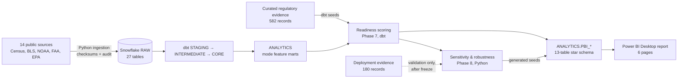

# Autonomous Mobility Network Expansion Strategy

**A data-driven market-readiness and prioritization system for robotaxis, sidewalk delivery robots and drone delivery across the 35 largest U.S. metropolitan areas.**

> **Independent portfolio project.** This is an independent analysis inspired by public developments in autonomous mobility. It is not affiliated with, sponsored by, or performed for Uber or any autonomous-vehicle, delivery-robot or drone company. It uses only public data, has no access to proprietary operator data, and represents no company's views, plans or strategy. Regulatory content is an analytical classification, not legal advice.

---


<p align="center"><em>Overview page of the six-page Power BI dashboard. More pages are in the <a href="#power-bi-dashboard-six-pages">dashboard gallery</a>.</em></p>

## Executive overview

Expansion decisions for autonomous mobility depend on more than market size. Demand intensity, weather, labor economics, the built environment and, above all, state law decide where a service can launch and succeed.

This project builds an end-to-end, auditable decision system:
- **Warehouse.** 14 public statistical sources (Census, BLS, NOAA, FAA, EPA) are landed as 27 RAW tables in Snowflake and transformed with dbt, alongside 582 manually curated regulatory evidence records.
- **Readiness models.** Each of the three modes has its own transparent readiness model, scored against the curated regulatory evidence.
- **Stress tests.** Each mode's ranking is tested under 10,000 random component weightings, named business and regulatory scenarios, two alternative normalizations and 13 one-at-a-time methodology tests.
- **Delivery.** Results are presented in a six-page Power BI Desktop report.

The system separates three kinds of result:
- **Baseline:** the result under the documented model.
- **Robust:** results that hold across the tested assumptions.
- **Assumption-dependent:** results that move when priorities or unresolved law change.

It never declares a single "best city overall": readiness is scored and ranked separately for each mode.

## Business problem and strategic objectives

> *Which U.S. metropolitan markets appear most attractive for autonomous ride-hailing and delivery expansion, and how do those conclusions change under different business priorities and regulatory assumptions?*

Objectives:
1. Rank the 35 largest U.S. MSAs separately for **robotaxi**, **sidewalk delivery robot** and **drone delivery** readiness.
2. Make every score explainable: decompose it into components and features, with documented sources.
3. Treat regulation as **evidence**, not anecdote. Never score a market as unfavorable merely because its law could not be verified.
4. Distinguish robust opportunities from assumption-sensitive ones, using sensitivity and scenario analysis.
5. Check the results against real-world deployments **only after** the model was frozen, as an external reasonableness check, never as a tuning target.

## Key analytical findings

All figures come from the committed outputs in `outputs/phase7/` (baseline) and `outputs/phase8/` (sensitivity, scenarios and deployment validation). Regulatory and deployment evidence is as of 2026-10-05. Frequencies are shares of the 10,000 tested weight draws, not probabilities of commercial success.

| Finding | Result type | Evidence |
|---|---|---|
| **Robotaxi has a stable leading group: San Francisco, Los Angeles and San Diego** | Baseline + sensitivity | Baseline ranks 1–3 (scores 91.8, 86.0, 83.8). Top 5 in 100%, 100% and 96.2% of 10,000 random component-weight draws. Ranked 1–3 under every named business scenario, both alternative normalizations and all 10 robotaxi one-at-a-time methodology tests. They are the only markets in any mode flagged *consistent top performer* |
| **Below the leading group, robotaxi order depends on priorities** | Sensitivity | Baseline ranks 4–10 (Denver, Miami, Sacramento, Phoenix, Tampa, Orlando, Austin) have 90% rank intervals 10–13 positions wide across the weight draws (Denver: 4th–17th) |
| **Unresolved regulation can move markets a long way** | Regulatory scenarios | Boston and New York are unranked at baseline because their state evidence is incomplete. As unverified law is treated pessimistically, neutrally or optimistically, Boston (robotaxi) ranks 20th, 8th or 4th and New York ranks 18th, 14th or 7th |
| **Drone: Pittsburgh, Portland and Dallas are the most stable drone leaders** | Baseline + sensitivity | Baseline ranks 1, 2 and 4. Top 10 in 95.5%, 93.7% and 95.8% of weight draws, although no drone market meets the *consistent top performer* test. Ten drone markets, including Los Angeles, San Francisco and Sacramento, are unscored pending state preemption evidence. Sacramento would rank 1st under the neutral and optimistic regulatory bounds (9th under the pessimistic bound) |
| **Sidewalk: the ranking depends on how heavily state statutes are weighted** | Baseline + business scenarios | California had no personal-delivery-device statute as coded, so San Francisco, Los Angeles and San Diego score 0 on regulation (C4). Their non-regulatory scores are still the three highest, and they rank 1st, 2nd and 5th at baseline. Under the Regulatory Priority scenario, statute states lead (Dallas, Miami, Austin, Phoenix, Houston) and San Francisco falls to 14th. San Francisco is top 5 in 79.3% of weight draws, and no sidewalk market is a consistent top performer |
| **Normalization choice matters little; weights and the treatment of statutory absence matter more** | Sensitivity | Spearman rank correlation with the baseline is 0.962–0.989 under the two min-max alternatives, and ≥ 0.989 under the alternative airport, density, weather-station and wind methods. Giving half credit for statutory absence produces the lowest correlation of any test (0.886, drone) |
| **Robotaxi readiness broadly aligns with current deployments, without being tuned to them** | External validation | Robotaxi markets with a current commercial service have a median baseline rank of 9, against 22.5 for markets without one. All 5 baseline top-5 robotaxi markets have a commercial service, although 15 of the 29 ranked markets do. The gap is smaller for drone (median 10 vs 15) and sidewalk (10 vs 18.5). This is a descriptive check run after the model was frozen, not a measure of accuracy |

**Data coverage:** 29 robotaxi, 31 sidewalk and 25 drone markets (of 35) have a complete baseline score. The rest (6, 4 and 10) are **left unranked** rather than scored as zero or imputed. For at least one scored regulatory dimension, part of their population is covered only by unknown or LOW-confidence evidence.

## Technology stack

| Layer | Tools |
|---|---|
| Ingestion and QA | **Python** 3.13 (pandas, numpy, requests, openpyxl, snowflake-connector-python) |
| Warehouse | **Snowflake**: key-pair authentication, least-privilege roles, a META audit schema |
| Transformation and scoring | **dbt Core** 1.12 (dbt-snowflake) with **SQL**: 789 nodes (90 models, 13 seeds, 686 data tests), all passing at the last full build (2026-10-07) |
| Analysis | Python: feature audit, independent score reconciliation, seeded Monte Carlo sensitivity |
| BI | **Power BI** Desktop (.pbix) report with **DAX** measures, built on the `ANALYTICS.PBI_*` tables |

## End-to-end data architecture



**Design principles:**
- **Pinned inputs.** Every source vintage is fixed in the ingestion registry, and every load records a SHA-256 checksum and an audit entry in the META schema.
- **Tested at every layer.** Tests cover grain, keys and relationships, plus guards against deployment leakage and against scores appearing before their phase.
- **Reconciled independently.** The Phase 7 baseline scores are recomputed in Python and reconciled to the dbt output within a 1e-6 tolerance.
- **Isolated validation data.** Deployment evidence is used only in the post-freeze validation outputs and never reaches a feature or scoring relation (enforced by a dbt test).
- **Reproducible sensitivity.** The sensitivity analysis uses a fixed random seed (20261007). Two complete runs of the Phase 8 scripts produced byte-identical outputs (32 of 32 files).

## Data sources and provenance

| Category | Source | Dataset and vintage | Used for |
|---|---|---|---|
| Population and markets | U.S. Census Bureau / OMB | PEP Vintage 2025; CBSA delineation (July 2023) | 35-market universe; population (C1) |
| Demographics | U.S. Census Bureau | ACS 5-year 2020–2024: B08301, B19013, B25024 (CBSA); B01003 (tract) | Ride-hail use, income, density (C1); detached housing (C5) |
| Geography | U.S. Census Bureau | Gazetteer 2024; Census Geocoder | Density, airport and weather-station mapping |
| Business activity | U.S. Census Bureau | County Business Patterns 2023 | Retail, restaurant and business density (C1, C3) |
| Labor costs | U.S. Bureau of Labor Statistics | OEWS May 2025 (shuttle drivers and chauffeurs; couriers) | Economic attractiveness (C3) |
| Climate | NOAA NCEI | U.S. Climate Normals 1991–2020; HOMR station history | Operating environment (C2) |
| Air travel | Federal Aviation Administration | CY2025 enplanements; NASR airport data | Airport demand (robotaxi C1) |
| Built environment | U.S. EPA | Smart Location Database v3.0 (Walkability Index; 2017–2020 inputs) | Sidewalk mode fit (C5) |
| Regulation | State legislatures and agencies; eCFR, Federal Register, FAA | 582 curated records (573 state; 9 federal, context only) | Regulatory readiness (C4; state law only) |
| Deployment (validation only) | Operator and platform announcements; press | 180 records, 22 distinct operators | External reasonableness check; never scored |

**Provenance:**
- **Statistical sources** come from official files and APIs, are pinned by vintage, and are checksummed on ingestion. Their 14 source IDs are registered as 17 ingestion entries in `config/ingestion_sources.json`, landing 27 RAW tables.
- **Legal and deployment evidence** is curated manually and committed as CSV files in `evidence/`, not downloaded. Every record carries a citation, verification status and confidence.
- **Full catalogue:** [docs/data_sources.md](docs/data_sources.md).

## Market readiness scoring methodology

**Components.** Every mode shares one five-component framework. Each mode has 10 active features, plus scored regulatory dimensions: 3 for robotaxi, 3 for sidewalk and 1 for drone.

| Component | Examples |
|---|---|
| C1 Demand & Market Opportunity | Population, population-weighted density, ride-hail share, income, retail and restaurant density |
| C2 Operating Environment | Precipitation days, days ≥ 90°F, snowfall; drone: mean wind |
| C3 Economic Attractiveness | Occupational wages (the human-labor cost being automated), business density |
| C4 Regulatory & Autonomy Readiness | Verified state law: driverless operation, commercial service, local preemption, delivery-device statutes |
| C5 Infrastructure & Mode Fit | Sidewalk: walkability; drone: single-family detached share. **Robotaxi has no C5**: no defensible measure exists, so it is structurally absent rather than set to zero |

**Scoring rules:**
- **Normalization.** Features are scored as cross-sectional average-rank percentiles (0–100) across the 35 markets, in a documented direction; for example, fewer extreme-weather days is better. Only transformations approved in Phase 6 are applied.
- **Regulation.** Categorical regulatory dimensions are scored as the **verified favorable share of market population**: multi-state metros are weighted by each state's population share. Sidewalk's weight-limit dimension is instead percentile-ranked on the most restrictive verified limit. C4 is the equal-weight mean of the mode's dimensions.
- **Eligibility.** Only state evidence that is primary-verified and of MEDIUM/HIGH confidence enters the score. A market with any unknown or LOW-confidence population share in any regulatory dimension gets no C4, baseline score or rank for that mode (no imputation). It is **unranked**.
- **Weights.** The baseline uses equal weights within components and across active components: 25% each for robotaxi, 20% each for sidewalk and drone. These are a neutral baseline, not a claim that the components are equally important.
- **Explainability.** Every score decomposes exactly into feature contributions.

Details: [docs/readiness_model.md](docs/readiness_model.md) · [docs/score_reconciliation.md](docs/score_reconciliation.md)

## Sensitivity and scenario analysis

| Test | Design |
|---|---|
| Component weights | 10,000 Dirichlet(α = 1) draws per mode, seed 20261007: top-1/3/5/10 frequency, mean, median, best and worst rank |
| Business scenarios | NEUTRAL plus one priority scenario per component (priority component at 40%; robotaxi has no infrastructure scenario) |
| Normalization | Raw min-max and 5th–95th percentile winsorized min-max, against the percentile baseline |
| Regulatory uncertainty | Pessimistic, neutral and optimistic bounds (unknown share 0%, 50% or 100% favorable), never averaged. Robotaxi also gets weight sensitivity nested under each bound |
| Methodology (one at a time) | 13 tests in all, each applied to the modes it affects (24 mode–test runs). Four feature drops: income, wage, density, and the robotaxi commercial-service dimension. One alternative airport mapping, block-group density, three alternative weather-station rules and p90 wind. Three regulatory-coding variants: half credit for statutory absence, confidence-only eligibility, and unadjusted Nevada scope |

Frequencies are reported as "share of tested weight configurations", never as a probability of being the best market. Details: [docs/robustness_and_sensitivity.md](docs/robustness_and_sensitivity.md).

## Power BI dashboard (six pages)

The final report is `powerbi/Autonomous_Mobility_Expansion_Strategy.pbix`, a Power BI Desktop file built on the `ANALYTICS.PBI_*` publication tables. It is distributed as a PBIX; no Power BI Service deployment is included.

| Page | Purpose |
|---|---|
| **Overview** | Executive summary by mode (mode selector): readiness map, top 5 markets, readiness vs. weight-draw stability, and decision insights |
| **Robotaxi** | Robotaxi readiness map, top markets and ranks under the pessimistic, neutral and optimistic regulatory bounds |
| **Autonomous Delivery** | Sidewalk-robot and drone readiness, shown one mode at a time and never combined into one score |
| **Market Comparison** | Side-by-side comparison of user-selected markets: component scores, a scorecard and rank ranges across weightings |
| **Scenario Simulator** | Predefined scenarios chosen from selectors: a business-priority scenario (neutral, or one component at 40%) and a regulatory bound. Results are shown against the baseline. The page has no custom weight inputs |
| **Methodology** | Static summary of architecture, scoring approach, scenario and robustness design, data sources and limitations |

### Robotaxi


### Scenario Simulator


### All pages

<table>
  <tr>
    <td align="center"><a href="powerbi/screenshots/01_overview.png"></a><br><b>1. Overview</b></td>
    <td align="center"><a href="powerbi/screenshots/02_robotaxi.png"></a><br><b>2. Robotaxi</b></td>
    <td align="center"><a href="powerbi/screenshots/03_autonomous_delivery.png"></a><br><b>3. Autonomous Delivery</b></td>
  </tr>
  <tr>
    <td align="center"><a href="powerbi/screenshots/04_market_comparison.png"></a><br><b>4. Market Comparison</b></td>
    <td align="center"><a href="powerbi/screenshots/05_scenario_simulator.png"></a><br><b>5. Scenario Simulator</b></td>
    <td align="center"><a href="powerbi/screenshots/06_methodology.png"></a><br><b>6. Methodology</b></td>
  </tr>
</table>

Click any thumbnail for the full-size image. Original specification and build notes: [docs/powerbi_dashboard_spec.md](docs/powerbi_dashboard_spec.md) · [docs/powerbi_semantic_model.md](docs/powerbi_semantic_model.md) · [powerbi/measures.md](powerbi/measures.md) · [docs/kpi_dictionary.md](docs/kpi_dictionary.md). The specification also describes features the final report does not implement: What-If weight sliders, drillthrough and tooltip pages, and the custom theme in `powerbi/theme.json`.

## Strategic business implications

**How to read this section:**
- **What the model measures.** It measures market *readiness* from public data: demand, operating environment, labor economics, infrastructure and verified state law. It does not estimate profitability, demand capture, competitive intensity or operational feasibility, and it uses no Uber or operator data.
- **What each recommendation covers.** Each one states what the model found, why it matters commercially, the action it supports, and the evidence still needed before acting.
- **Two kinds of evidence, kept apart:**
  - **A. Analytical findings** come from the frozen model and the **2026-10-05** evidence snapshot.
  - **B. Supplementary business context** comes from public primary sources checked on **2026-10-30**. It was **not** used in scoring.

### A. Findings from the model (evidence snapshot 2026-10-05)

#### Robotaxi: separate readiness from market maturity

A high readiness rank does not mean an open market. The strongest robotaxi markets are also the most contested. The commercial question differs by market type.

- **Established autonomous markets: San Francisco (#1) and Los Angeles (#2).**
  - **Found:** Both are top 5 in 100% of weight draws and rank 1–2 under every named scenario and methodology test. Both already had driverless commercial robotaxi service in the snapshot (Waymo, since 2024).
  - **Why it matters:** The readiness case is the strongest in the study, but these are not whitespace. Any new autonomous offer competes with an incumbent driverless service.
  - **Action:** Treat them as competitive-entry or partnership markets, where differentiation, vehicle supply and platform reach matter more than market selection.
  - **Before acting:** Evidence the model does not contain: incumbent service-area coverage and growth, rider demand and pricing, and operator or vehicle availability.
- **Established, recently opened: San Diego (#3).**
  - **Found:** Top 5 in 96.2% of weight draws; ranks 1–3 in every named scenario and methodology test. The snapshot recorded a limited (invitation-only) Waymo commercial service from 2026-09-01. The service has since opened to all riders (see B).
  - **Why it matters:** San Diego is moving from early access to an established market. That narrows the window to be an early autonomous entrant.
  - **Action:** Prioritize it for competitive monitoring and partnership evaluation, not for "first entry".
  - **Before acting:** The incumbent's service-area expansion, airport access and adoption data.
- **Pre-commercial early-entry candidate: Sacramento (#6).**
  - **Found:** Ranks 6th at baseline, top 10 in 71.6% of weight draws. No commercial robotaxi deployment was recorded in the snapshot, only Waymo testing. Its weakest component is demand (C1).
  - **Why it matters:** It is the highest-ranked robotaxi market without a recorded commercial service. It is not untouched whitespace, though: an operator is already testing there and has named it as an upcoming market (see B). The opportunity is an early-entry window before commercial service begins, in a market whose demand base is thinner than the leaders'.
  - **Action:** Shortlist it for early-entry or pilot evaluation, with timing judged against the incumbent's launch.
  - **Before acting:** Core-city demand and trip-density analysis, the operator or vehicle partner and its timing, and the city's permitting stance.
- **Regulatory-uncertainty market: Boston (unranked).**
  - **Found:** Boston has no baseline rank because its Massachusetts evidence is incomplete. It ranks 20th, 8th or 4th as that unknown law is assumed unfavorable, half-favorable or favorable. Under the optimistic bound it is top 5 in 69% of weight draws.
  - **Why it matters:** The underlying market is competitive. The decision turns almost entirely on one unresolved legal question, so the payoff from resolving it is high. New York shows the same pattern (18th / 14th / 7th).
  - **Action:** Hold investment decisions and fund legal and policy due diligence first.
  - **Before acting:** Primary-source confirmation of Massachusetts driverless-operation and commercial-service law, plus municipal requirements, which the model does not code.
- **Mid-table markets (baseline ranks 4–10).**
  - **Found:** Rank intervals are 10–13 positions wide across weightings.
  - **Action:** Order them only after choosing explicit business priorities (Scenario Simulator), not from the baseline sequence.

#### Sidewalk delivery: strong fundamentals versus regulatory exposure

- **Found:** San Francisco, Los Angeles and San Diego have the three highest non-regulatory scores and rank 1st, 2nd and 5th at baseline. California's regulatory component (C4) scores **0**: as coded, it has no personal-delivery-device statute. When regulatory readiness is weighted at 40%, statute states take the top five (Dallas, Miami, Austin, Phoenix, Houston) and San Francisco falls to **14th**. No sidewalk market is a consistent top performer.
- **Why it matters:** The trade-off is between fundamentals and regulatory exposure, not a hard barrier. Los Angeles already had commercial sidewalk-robot service in the snapshot (Serve Robotics and Coco Robotics, with Uber Eats among the recorded platform partners) despite the absence of a statute. That suggests city-level permitting can make operations possible where state law is silent.
- **Action:** Pursue two tracks:
  - **Statute markets** (e.g. Dallas, Miami) for repeatable, lower-regulatory-risk scaling. Both already had commercial sidewalk service in the snapshot, so they are competitive rather than empty.
  - **California markets** for their demand and walkability, entered city by city through municipal permits.
- **Before acting:** Municipal permit regimes (not coded in the model), unit economics and delivery density, and the operator or partner footprint.

#### Drone delivery: robust leaders, and a high-value regulatory question

- **Robust candidates: Pittsburgh (#1), Portland (#2) and Dallas (#4).**
  - **Found:** They are top 10 in 95.5%, 93.7% and 95.8% of weight draws. Pittsburgh and Dallas are not weight-sensitive; Portland is. None meets the model's formal *consistent top performer* criterion. The snapshot shows four commercial drone operators in Dallas, only an announcement for Portland, and no drone activity recorded in Pittsburgh.
  - **Why it matters:** Similar readiness can mean very different competitive positions. Dallas is an established, multi-operator drone market. Pittsburgh combines the top drone baseline rank with no drone deployment in the snapshot. That makes it a **priority candidate for drone pilot feasibility assessment**, not an established whitespace opportunity. The absence of a record is not proof that no activity or plans exist.
  - **Action:** Prioritize Pittsburgh for a drone pilot feasibility assessment, starting with verification of current operator activity. Treat Dallas as a partnership or competitive market, and Portland as a candidate whose rank depends on priorities.
  - **Before acting:** Airspace and site constraints (FAA authorizations are not scored), local ordinances, and the delivery-partner ecosystem.
- **Regulatory uncertainty: Sacramento and the California metros.**
  - **Found:** Ten drone markets are unscored because state preemption evidence is incomplete. Five are in California: Los Angeles, Riverside, Sacramento, San Diego and San Francisco. Sacramento ranks **9th** under the pessimistic bound and **1st** under both the neutral and optimistic bounds.
  - **Why it matters:** Settling one state-law question (California's preemption of local drone rules) would bring five large markets into the comparison at once. One of them could become the leading drone market.
  - **Action:** Make California drone-preemption research a priority before finalizing any drone shortlist.
  - **Before acting:** A primary-source legal determination; the model's neutral bound is itself an assumption (50% favorable), not evidence.

### Decision framework

| Market / mode | Analytical evidence (2026-10-05 snapshot) | Strategic opportunity | Next decision or validation |
|---|---|---|---|
| San Francisco, Los Angeles / robotaxi | Ranks 1–2; top 5 in 100% of draws; driverless incumbent present | Competitive entry or partnership, not whitespace | Incumbent coverage, rider demand, vehicle supply |
| San Diego / robotaxi | Rank 3; top 5 in 96.2%; limited incumbent service since Sept 2026 | Closing early-entry window | Incumbent expansion and adoption |
| Sacramento / robotaxi | Rank 6; testing only, no commercial service recorded; demand is the weakest component | Pre-commercial early-entry window | Core-city demand, launch timing versus the incumbent, city permitting |
| Boston / robotaxi | Unranked; 20th / 8th / 4th under regulatory bounds | Option value conditional on law | Massachusetts legal due diligence before any investment |
| California metros / sidewalk | Top non-regulatory scores; C4 = 0; SF falls to 14th under regulatory priority | Strong fundamentals, permit-dependent entry | Municipal permit regimes, unit economics |
| Dallas, Miami / sidewalk | Statute states; lead under regulatory priority; existing commercial service | Lower regulatory-risk scaling in competitive markets | Partner footprint, delivery density |
| Pittsburgh / drone | Rank 1; top 10 in 95.5%; not weight-sensitive; no drone deployment recorded | Priority candidate for drone pilot feasibility assessment | Current operator activity, airspace, sites, partner ecosystem |
| Dallas / drone | Rank 4; top 10 in 95.8%; four commercial operators | Partnership or competitive market | Differentiation and partner availability |
| Sacramento and California / drone | Unscored; Sacramento 9th / 1st / 1st under regulatory bounds | One legal question unlocks five markets | California preemption research |

Market selection is one input among several. Real deployments also reflect operator footprint, partnerships and capital, which public data cannot observe.

### B. Supplementary public context (verified 2026-10-30; not used in scoring)

These developments postdate or sit outside the evidence snapshot. They are reported from company sources to show how the readiness findings meet the current market. They were not fed back into the model, which stays frozen at 2026-10-05. These are planned or newly launched autonomous services. Some are offered through the Uber platform, which is distinct from Uber's conventional human-driven ride-hailing; Waymo's services are booked in Waymo's own app.

| Market | Development | Status per primary source | Source |
|---|---|---|---|
| San Francisco Bay Area | Nuro / Lucid / Uber robotaxi (Lucid Gravity, Nuro Driver, Uber app) | Autonomous on-road testing with safety operators. Launch planned "later this year" (Uber, 2026-06-17). Lucid reported the program "in active testing and validation" (2026-08-04). No public-launch announcement found as of 2026-10-30 | [Uber](https://investor.uber.com/news-events/news/press-release-details/2026/Uber-Nuro-and-Lucid-to-Bring-Robotaxi-Service-to-Houston-in-2027/default.aspx); [Lucid 8-K](https://www.sec.gov/Archives/edgar/data/0001811210/000162828026052548/q2fy26ex991earnings.htm) |
| Los Angeles | MOIA America / Uber autonomous ID. Buzz | On-road validation testing with onboard human operators. "Rides on the Uber platform are planned for late 2026" (2026-04-08). No public-launch announcement found as of 2026-10-30 | [Uber / MOIA](https://investor.uber.com/news-events/news/press-release-details/2026/MOIA-America-to-deploy-autonomous-ID--Buzz-vehicles-on-the-Uber-platform-in-Los-Angeles-by-the-end-of-2026-2026-sJHS8F1vOr/default.aspx) |
| San Diego | Waymo | Opened to all riders on 2026-10-14; first public riders from September 2026 | [Waymo](https://waymo.com/blog/shorts/sat-sd-tpa/) |
| SF Bay Area, Los Angeles, San Diego | Waymo | Listed under "Serving Riders In" | [Waymo updates](https://waymo.com/updates/) |
| Sacramento, Boston | Waymo | Listed under "Up Next". Sacramento: manual driving began February 2026, public riders "in the future" | [Waymo updates](https://waymo.com/updates/); [Waymo](https://waymo.com/blog/shorts/waymo-is-headed-to-sacramento/) |

Company timelines are forward-looking statements and may change.

## Reproduction

The original Snowflake account used to build this project is no longer active, so reproducing it requires your own account. The committed outputs (`outputs/`, `dbt/seeds/`) and the PBIX can be reviewed without one.

Prerequisites:
- Python 3.13;
- a Snowflake account with access to the SYSADMIN, SECURITYADMIN and ACCOUNTADMIN roles;
- a free [Census API key](https://api.census.gov/data/key_signup.html);
- Power BI Desktop.

```powershell
git clone https://github.com/priyaareti14/autonomous-mobility-expansion-strategy.git
cd autonomous-mobility-expansion-strategy
python -m venv .venv; .venv\Scripts\Activate.ps1
pip install -r requirements.txt
copy .env.example .env                          # fill in your own values (never commit .env)
copy dbt\profiles.example.yml dbt\profiles.yml  # credentials come from environment variables; role, database and warehouse are set in the file
```

1. **Snowflake.** First generate an encrypted RSA key pair (PKCS#8) and store it outside the repository. Then run `snowflake/setup/01`–`05` in order, using the roles each script names (03 needs ACCOUNTADMIN), and paste your public key into `04_service_user.sql`. The scripts create the database, schemas, roles, warehouse, resource monitor, key-pair service user and audit tables ([docs/snowflake_foundation.md](docs/snowflake_foundation.md)).
2. **Ingest and validate.** Run `python scripts/run_ingestion.py --all`, then `python scripts/validate_raw_landing.py`.
3. **Transform and score:**
   - `python scripts/build_regulatory_seed.py --check`
   - `python scripts/run_dbt.py build --threads 2`
4. **QA and sensitivity:**
   - `python scripts/run_phase7_scoring_qa.py`
   - `python scripts/run_phase8_sensitivity.py`
   - `python scripts/run_phase8_deployment_validation.py`
5. **Publication layer:**
   - `python scripts/build_powerbi_seeds.py`, then `python scripts/build_powerbi_seeds.py --check`
   - `python scripts/run_dbt.py build --threads 2`
   - `python scripts/run_phase9_publication_qa.py`
6. **Dashboard.** Open the PBIX in Power BI Desktop, point its Snowflake source at your account (role `AM_ANALYST`, warehouse `AM_EXPANSION_WH`) with a login that has been granted `AM_ANALYST`, and refresh.

The full sequence is in [docs/powerbi_refresh_workflow.md](docs/powerbi_refresh_workflow.md).

Raw source files are not stored in the repository. Ingestion downloads them from the official URLs and APIs in `config/ingestion_sources.json`. Regulatory and deployment evidence is committed in `evidence/`.

Upstream files can be revised or withdrawn. For example, the FAA NASR file is a dated 28-day-cycle snapshot, and the PEP file is checksum-pinned and blocks on any change. A fresh ingestion may therefore fail or differ from the committed outputs.

## Limitations and assumptions

- **Market definition.** A CBSA is not a service area. Real services cover part of a metro.
- **Regulation coverage.** Only state law is scored; federal records are context only, and municipal ordinances are not coded. The evidence is point-in-time (2026-10-05) and is not legal advice; laws and deployments may have changed since. Some states could not be verified with eligible evidence, which leaves 6 robotaxi, 4 sidewalk and 10 drone markets unranked.
- **Mixed vintages.** PEP 2025, ACS 2020–2024, CBP 2023, OEWS May 2025, Climate Normals 1991–2020, EPA SLD inputs from 2017–2020.
- **Percentile scoring** discards magnitude. Equal weights do not mean equal influence: the regulatory component (C4) accounts for 62% of drone and 45% of robotaxi score variance.
- **Deployment comparison** is a reasonableness check, not accuracy. No recorded deployment is not evidence of unsuitability.
- **No causal claims** are made. The dashboard's Scenario Simulator displays precomputed Phase 8 scenario results; it does not re-estimate or re-weight the model interactively.

The full register is [docs/assumptions_and_limitations.md](docs/assumptions_and_limitations.md): 70 entries, each with its rationale and potential impact.

## Repository structure

```
config/      ingestion registry and regulatory feature contract
src/         Python packages: ingestion, analytics, Snowflake connection
scripts/     entry points: ingestion, validation, QA, sensitivity, publication
snowflake/   warehouse setup and validation SQL
dbt/         models (staging → intermediate → core → marts → scoring → powerbi), seeds, tests, macros
evidence/    curated regulatory and deployment evidence, with the research protocol
outputs/     analytical results by phase (feature audit, scores, robustness, publication QA)
powerbi/     final report (.pbix), screenshots, data dictionary, and the original DAX, theme and build-guide specifications
docs/        methodology and technical documentation (start at docs/README.md)
```

Documentation guide: **[docs/README.md](docs/README.md)**.

## License

The original code and documentation are released under the [MIT License](LICENSE). Third-party datasets (U.S. Census Bureau, BLS, NOAA, FAA, EPA and others) and cited legal and deployment sources remain subject to their providers' own licenses and terms of use. See [NOTICE.md](NOTICE.md).
