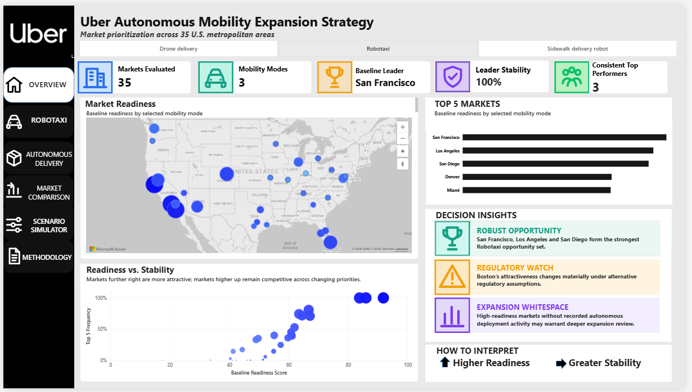
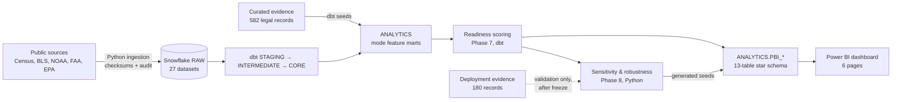
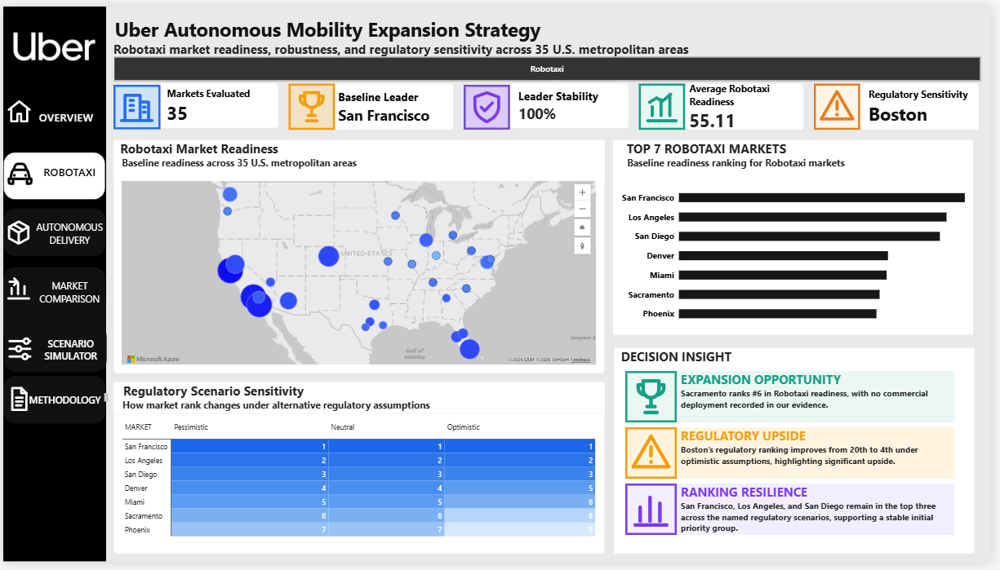
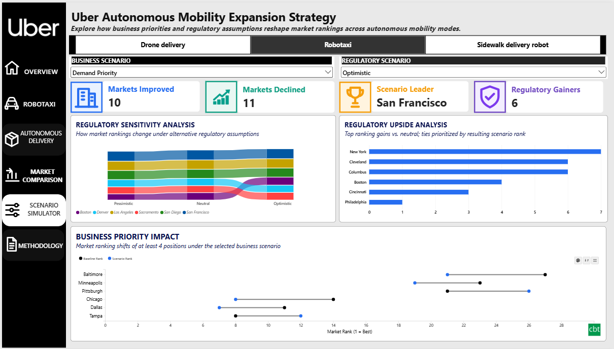
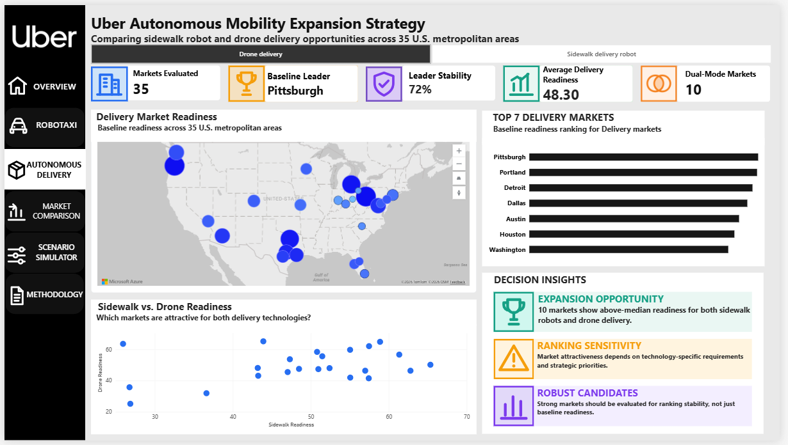
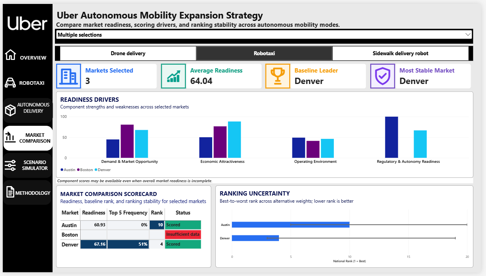
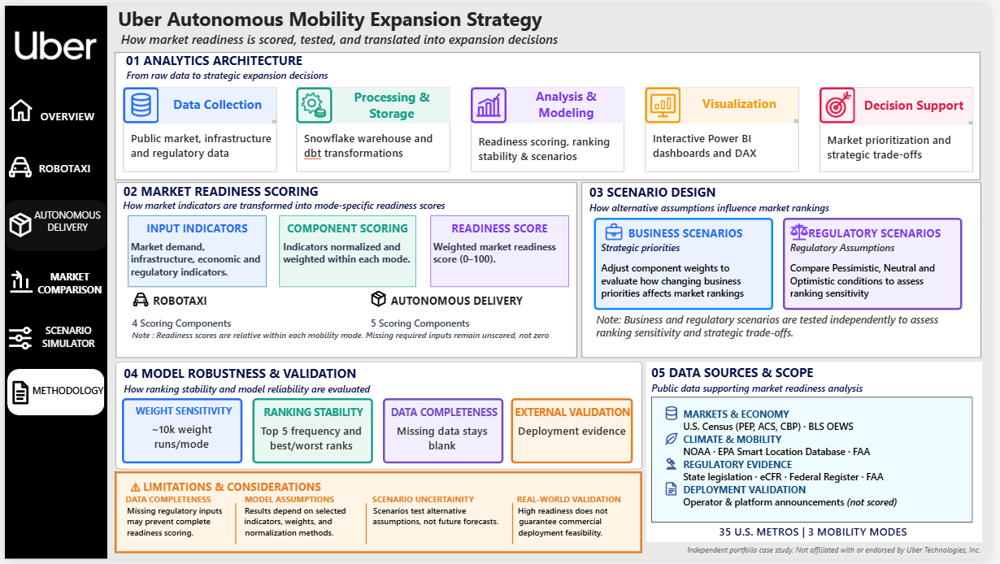

# Autonomous Mobility Network Expansion Strategy

**A data-driven market-readiness and prioritization system for robotaxis, sidewalk delivery robots and drone delivery across the 35 largest U.S. metropolitan areas.**

> **Independent portfolio project.** This is an independent analysis inspired by public developments in autonomous mobility. It is not affiliated with, sponsored by, or performed for Uber or any autonomous-vehicle, delivery-robot or drone company. It uses only public data, has no access to proprietary operator data, and represents no company's views, plans or strategy. Regulatory content is an analytical classification, not legal advice.

---


<p align="center"><em>Overview page of the six-page Power BI dashboard. More pages are in the <a href="#power-bi-dashboard-six-pages">dashboard gallery</a>.</em></p>

## Executive overview

Expansion decisions for autonomous mobility depend on more than market size. Demand intensity, weather, labor economics, the built environment and, above all, state law decide where a service can launch and succeed.

This project builds an end-to-end, auditable decision system:
- **Warehouse.** 27 public datasets are ingested into Snowflake and transformed with dbt.
- **Readiness models.** Each mode has its own transparent readiness model, scored against curated regulatory evidence.
- **Stress tests.** Every ranking is tested under 10,000 alternative weightings and a set of methodology changes.
- **Delivery.** Results are published to a six-page Power BI dashboard.

The system separates three kinds of result:
- **Baseline:** the result under the documented model.
- **Robust:** results that hold across the tested assumptions.
- **Assumption-dependent:** results that move when priorities or unresolved law change.

It never declares a single "best city overall": readiness is scored and ranked separately for each mode.

## Business problem and strategic objectives

> *Which U.S. metropolitan markets appear most attractive for autonomous ride-hailing and delivery expansion, and how do those conclusions change under different business priorities and regulatory assumptions?*

Objectives:
1. Rank the 35 largest U.S. MSAs separately for **robotaxi**, **sidewalk delivery robot** and **drone delivery** readiness.
2. Make every score explainable: decompose it into components and features, with documented sources.
3. Treat regulation as **evidence**, not anecdote. Never score a market as unfavorable merely because its law could not be verified.
4. Distinguish robust opportunities from assumption-sensitive ones, using sensitivity and scenario analysis.
5. Check the results against real-world deployments **only after** the model was frozen, as an external reasonableness check, never as a tuning target.

## Key analytical findings

All figures come from the committed outputs in `outputs/phase7/` and `outputs/phase8/`. The evidence date is 2026-10-05.

| Finding | Evidence |
|---|---|
| **Robotaxi has a stable leading group: San Francisco, Los Angeles and San Diego** | Baseline ranks 1–3 (scores 91.8, 86.0, 83.8). Top 5 in 100%, 100% and 96.2% of 10,000 component-weight configurations. Ranked 1–3 under every named business scenario, both alternative normalizations and every robotaxi one-at-a-time methodology test. They are the only markets flagged *consistent top performer* |
| **Below the leading group, robotaxi order depends on priorities** | Ranks 4–10 (Denver, Miami, Sacramento, Phoenix, Tampa, Orlando, Austin) have 90% rank intervals spanning 10–13 positions across weightings |
| **Unresolved regulation can move markets a long way** | Boston (robotaxi) ranks 20th, 8th or 4th as unverified Massachusetts law is treated pessimistically, neutrally or optimistically. New York ranks 18th, 14th or 7th |
| **Drone: Pittsburgh, Portland and Dallas are consistently strong** | Top 10 in 95.5%, 93.7% and 95.8% of weight configurations. Ten drone markets, including Los Angeles, San Francisco and Sacramento, are unscored pending state preemption evidence. Under an optimistic bound, Sacramento would rank 1st |
| **Sidewalk: statutes are the binding constraint** | The California markets lead on demand, labor-cost and walkability fundamentals, but California has no personal-delivery-device statute. San Francisco is top 5 in 79.3% of configurations, and no sidewalk market is a consistent top performer |
| **Normalization choice matters little; weights and statutory absence matter most** | Rank correlation with the baseline is 0.962–0.989 under min-max alternatives, and ≥ 0.989 under alternative airport, density, weather and wind mappings. Changing how statutory absence is treated gives the lowest correlation of any test, 0.886 |
| **The model aligns with real deployments without being tuned to them** | Robotaxi markets with a current commercial service have a median baseline rank of 9, against 22.5 for markets without one, and all 5 baseline top-5 robotaxi markets have a commercial service. This is an external check run after the model was frozen, not a measure of accuracy |

**Data coverage:** 29 robotaxi, 31 sidewalk and 25 drone markets have a complete baseline score. The rest are **left unranked** rather than scored as zero, because their regulatory evidence could not be verified from a primary source.

## Technology stack

| Layer | Tools |
|---|---|
| Ingestion and QA | **Python** 3.13 (pandas, numpy, requests, openpyxl, snowflake-connector-python) |
| Warehouse | **Snowflake**: key-pair authentication, least-privilege roles, a META audit schema |
| Transformation and scoring | **dbt Core** 1.12 with **SQL**: 789 nodes, including 686 data tests, all passing at the last build (2026-10-07) |
| Analysis | Python: feature audit, independent score reconciliation, seeded Monte Carlo sensitivity |
| BI | **Power BI** Desktop (Import mode), **DAX** measures, a custom theme |

## End-to-end data architecture



**Design principles:**
- **Pinned, reproducible inputs.** Every source vintage is fixed, and every load is checksummed and audited.
- **Tested at every layer.** Tests cover grain, keys and relationships, plus guards against deployment leakage and against scores appearing before their phase.
- **Reconciled independently.** Every published score is recomputed in Python and reconciled to 1e-6.
- **Isolated validation data.** Deployment evidence is confined to a single external-validation table and never reaches a scoring relation.
- **Reproducible sensitivity.** The sensitivity analysis uses a fixed random seed (20261007), and repeated runs produce byte-identical outputs.

## Data sources and provenance

| Category | Source | Dataset and vintage | Used for |
|---|---|---|---|
| Population and markets | U.S. Census Bureau / OMB | PEP Vintage 2025; CBSA delineation (July 2023) | 35-market universe; population (C1) |
| Demographics | U.S. Census Bureau | ACS 5-year 2020–2024: B08301, B19013, B25024 (CBSA); B01003 (tract) | Ride-hail use, income, density (C1); detached housing (C5) |
| Geography | U.S. Census Bureau | Gazetteer 2024; Census Geocoder | Density, airport and weather-station mapping |
| Business activity | U.S. Census Bureau | County Business Patterns 2023 | Retail, restaurant and business density (C1, C3) |
| Labor costs | U.S. Bureau of Labor Statistics | OEWS May 2025 (shuttle drivers and chauffeurs; couriers) | Economic attractiveness (C3) |
| Climate | NOAA NCEI | U.S. Climate Normals 1991–2020; HOMR station history | Operating environment (C2) |
| Air travel | Federal Aviation Administration | CY2025 enplanements; NASR airport data | Airport demand (robotaxi C1) |
| Built environment | U.S. EPA | Smart Location Database v3.0 (Walkability Index) | Sidewalk mode fit (C5) |
| Regulation | State legislatures and agencies; eCFR, Federal Register, FAA | 582 curated legal records | Regulatory readiness (C4) |
| Deployment (validation only) | Operator and platform announcements; press | 180 records, 22 operators | External reasonableness check; never scored |

**Provenance:**
- **Statistical sources** come from official files and APIs, are pinned by vintage, and are checksummed on ingestion. They are registered in `config/ingestion_sources.json`.
- **Legal and deployment evidence** is curated manually. Every record carries a citation, verification status and confidence (`evidence/`).
- **Full catalogue:** [docs/data_sources.md](docs/data_sources.md).

## Market readiness scoring methodology

**Components.** Every mode shares one five-component framework. Each mode has its own approved features (10 per mode, plus regulatory dimensions):

| Component | Examples |
|---|---|
| C1 Demand & Market Opportunity | Population, population-weighted density, ride-hail share, income, retail and restaurant density |
| C2 Operating Environment | Precipitation days, days ≥ 90°F, snowfall; drone: mean wind |
| C3 Economic Attractiveness | Occupational wages (the human-labor cost being automated), business density |
| C4 Regulatory & Autonomy Readiness | Verified state law: driverless operation, commercial service, local preemption, delivery-device statutes |
| C5 Infrastructure & Mode Fit | Sidewalk: walkability; drone: single-family detached share. **Robotaxi has no C5**: no defensible measure exists, so it is structurally absent rather than set to zero |

**Scoring rules:**
- **Normalization.** Features are scored as cross-sectional average-rank percentiles (0–100) in a documented direction; for example, fewer extreme-weather days is better. Only transformations approved in Phase 6 are applied.
- **Regulation.** Regulatory dimensions are scored as the **verified favorable share of market population**: multi-state metros are weighted by each state's population share.
- **Eligibility.** Only evidence that is primary-verified and of MEDIUM/HIGH confidence enters the score. A market with any unverified share is **unranked** for that mode.
- **Weights.** The baseline uses equal weights within components and across active components: 25% each for robotaxi, 20% each for sidewalk and drone. These are a neutral baseline, not a claim that the components are equally important.
- **Explainability.** Every score decomposes exactly into feature contributions.

Details: [docs/readiness_model.md](docs/readiness_model.md) · [docs/score_reconciliation.md](docs/score_reconciliation.md)

## Sensitivity and scenario analysis

| Test | Design |
|---|---|
| Component weights | 10,000 Dirichlet(α = 1) draws per mode, seed 20261007: top-1/3/5/10 frequency, mean, median, best and worst rank |
| Business scenarios | NEUTRAL plus one priority scenario per component (priority component at 40%; robotaxi has no infrastructure scenario) |
| Normalization | Raw min-max and 5th–95th percentile winsorized min-max, against the percentile baseline |
| Regulatory uncertainty | Pessimistic, neutral and optimistic bounds (unknown share 0%, 50% or 100% favorable), never averaged. Robotaxi also gets weight sensitivity nested under each bound |
| Methodology (one at a time) | Feature drops (income vs. wage, density), alternative airport mapping, block-group density, alternative weather stations, p90 wind, and three regulatory-coding variants: 13 tests in all |

Frequencies are reported as "share of tested weight configurations", never as a probability of being the best market. Details: [docs/robustness_and_sensitivity.md](docs/robustness_and_sensitivity.md).

## Power BI dashboard (six pages)

The final report is `powerbi/Autonomous_Mobility_Expansion_Strategy.pbix`, built in Power BI Desktop on the `ANALYTICS.PBI_*` publication tables.

| Page | Purpose |
|---|---|
| **Overview** | Executive summary: which markets look attractive for each mode, and how robust that conclusion is |
| **Robotaxi** | Robotaxi readiness: rankings, robustness and regulatory uncertainty |
| **Autonomous Delivery** | Sidewalk-robot and drone readiness, shown one mode at a time and never combined into one score |
| **Market Comparison** | Side-by-side comparison of selected markets |
| **Scenario Simulator** | Named business-priority scenarios and custom component weights, shown as scenario results, not the baseline |
| **Methodology** | Market universe, data sources, scoring approach, sensitivity design and limitations |

### Robotaxi



### Scenario Simulator



### All pages

<table>
  <tr>
    <td align="center"><a href="powerbi/screenshots/01_overview.png"></a><br><b>1. Overview</b></td>
    <td align="center"><a href="powerbi/screenshots/02_robotaxi.png"></a><br><b>2. Robotaxi</b></td>
    <td align="center"><a href="powerbi/screenshots/03_autonomous_delivery.png"></a><br><b>3. Autonomous Delivery</b></td>
  </tr>
  <tr>
    <td align="center"><a href="powerbi/screenshots/04_market_comparison.png"></a><br><b>4. Market Comparison</b></td>
    <td align="center"><a href="powerbi/screenshots/05_scenario_simulator.png"></a><br><b>5. Scenario Simulator</b></td>
    <td align="center"><a href="powerbi/screenshots/06_methodology.png"></a><br><b>6. Methodology</b></td>
  </tr>
</table>

Click any thumbnail for the full-size image. Specification and build: [docs/powerbi_dashboard_spec.md](docs/powerbi_dashboard_spec.md) · [docs/powerbi_semantic_model.md](docs/powerbi_semantic_model.md) · [powerbi/measures.md](powerbi/measures.md) · [docs/kpi_dictionary.md](docs/kpi_dictionary.md)

## Strategic business implications

- **Robotaxi: prioritize San Francisco, Los Angeles and San Diego with confidence.** They lead under every tested priority mix and methodology choice. Beyond that group, rank order is a priority decision: test candidate weightings explicitly (Scenario Simulator) rather than reading the baseline order as settled.
- **Resolve regulatory evidence before acting on Boston or New York (robotaxi).** Their rank swings widely with unverified state law (Boston 4th–20th, New York 7th–18th). Verifying it is the highest-value next research step.
- **Drone: Pittsburgh, Portland and Dallas are the most consistent opportunities among scored markets.** The large California metros need a preemption-law review before they can be compared.
- **Sidewalk delivery: regulation, not demand, limits the strongest markets.** Statute states (e.g. Texas and Florida metros) rise sharply when regulatory readiness is prioritized.
- **Market selection is one input among several.** Real deployments also reflect operator footprint, partnerships and capital, which public data cannot observe.

## Reproduction

Prerequisites:
- Python 3.13;
- a Snowflake account (the original trial account is no longer active, so use your own);
- a free [Census API key](https://api.census.gov/data/key_signup.html);
- Power BI Desktop.

```powershell
git clone https://github.com/priyaareti14/autonomous-mobility-expansion-strategy.git
cd autonomous-mobility-expansion-strategy
python -m venv .venv; .venv\Scripts\activate
pip install -r requirements.txt
copy .env.example .env                          # fill in your own values (never commit .env)
copy dbt\profiles.example.yml dbt\profiles.yml  # reads everything from environment variables
```

1. **Snowflake.** Run `snowflake/setup/*.sql` in order, as an administrator. It creates the database, schemas, roles, warehouse, service user and audit tables ([docs/snowflake_foundation.md](docs/snowflake_foundation.md)).
2. **Ingest and validate.** Run `python scripts/run_ingestion.py --all`, then `python scripts/validate_raw_landing.py`.
3. **Transform and score.** Run `python scripts/run_dbt.py build --threads 2`.
4. **QA and sensitivity:**
   - `python scripts/run_phase7_scoring_qa.py`
   - `python scripts/run_phase8_sensitivity.py`
   - `python scripts/run_phase8_deployment_validation.py`
5. **Publication layer:**
   - `python scripts/build_powerbi_seeds.py --check`
   - `python scripts/run_dbt.py build --threads 2`
   - `python scripts/run_phase9_publication_qa.py`
6. **Dashboard.** Open the PBIX and point its Snowflake connection at your account (role `AM_ANALYST`), or rebuild it from [powerbi/BUILD_GUIDE.md](powerbi/BUILD_GUIDE.md).

The full sequence is in [docs/powerbi_refresh_workflow.md](docs/powerbi_refresh_workflow.md). Raw source files are not stored in the repository; ingestion downloads them from the official URLs in `config/ingestion_sources.json`.

## Limitations and assumptions

- **Market definition.** A CBSA is not a service area. Real services cover part of a metro.
- **Regulation coverage.** Only state-level law is coded; municipal ordinances are not. The evidence is point-in-time (2026-10-05), and some states could not be verified from primary sources, which leaves 6 robotaxi, 4 sidewalk and 10 drone markets unranked.
- **Mixed vintages.** ACS 2020–2024, CBP 2023, OEWS May 2025, Climate Normals 1991–2020, EPA SLD inputs from 2017–2020.
- **Percentile scoring** discards magnitude. Equal weights do not mean equal influence: regulation explains 62% of drone and 45% of robotaxi score variance.
- **Deployment comparison** is a reasonableness check, not accuracy. No recorded deployment is not evidence of unsuitability.
- **No causal claims** are made, and the dashboard's scenario simulator re-weights published component scores; it does not re-estimate the model.

The full register is [docs/assumptions_and_limitations.md](docs/assumptions_and_limitations.md): 70 entries, each with its rationale and potential impact.

## Repository structure

```
config/      ingestion registry and regulatory feature contract
src/         Python packages: ingestion, analytics, Snowflake connection
scripts/     entry points: ingestion, validation, QA, sensitivity, publication
snowflake/   warehouse setup and validation SQL
dbt/         models (staging → intermediate → core → marts → scoring → powerbi), seeds, tests, macros
evidence/    curated regulatory and deployment evidence, with the research protocol
outputs/     analytical results by phase (feature audit, scores, robustness, publication QA)
powerbi/     final dashboard (.pbix), DAX measures, theme, data dictionary, build guide, screenshots
docs/        methodology and technical documentation (start at docs/README.md)
```

Documentation guide: **[docs/README.md](docs/README.md)**.

## License

The original code and documentation are released under the [MIT License](LICENSE). Third-party datasets (U.S. Census Bureau, BLS, NOAA, FAA, EPA and others) and cited legal and deployment sources remain subject to their providers' own licenses and terms of use. See [NOTICE.md](NOTICE.md).
